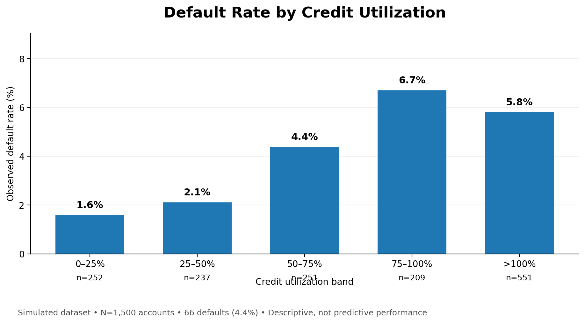
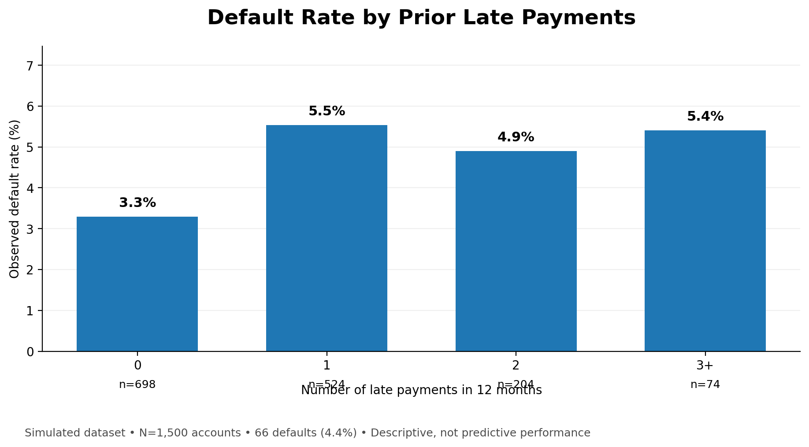

# Credit Card Default Risk Analysis

**Finance × Data Analytics | Python • Credit Risk • Decision Modeling**

## Overview

This project uses a **simulated credit-card dataset** to explore how financial institutions can estimate the probability of default and assess different credit-approval thresholds. The analysis combines exploratory data analysis, classification models, and a simplified expected-profit framework.

**Business question:** How do customer risk characteristics affect default predictions, and how might different probability-of-default (PD) cutoffs change the simulated portfolio's expected profitability?

## Tools and methods

- **Python:** pandas, NumPy, Matplotlib, scikit-learn
- **Models:** Logistic Regression and Random Forest
- **Evaluation:** ROC-AUC, ROC curves, classification reports, confusion matrices, feature importance
- **Finance:** Probability of default, loss given default, exposure at default, expected loss, approval-threshold simulation

## Repository contents

```text
Credit-Card-Default-Risk-Analysis/
├── Credit_Risk_Project_Notebook (1).ipynb
├── Credit_Risk_Report.pdf
├── credit_risk_dataset.csv
├── requirements.txt
└── README.md
```

All files are currently at the repository root. The structure above reflects the actual uploaded files, not a proposed future layout.

## Analytical workflow

1. Inspect the simulated dataset and default target.
2. Clean observations and engineer utilization-based features.
3. Explore risk indicators through charts and summary statistics.
4. Fit logistic regression and random forest models; evaluate discrimination using ROC-AUC.
5. Estimate account-level PD and simplified expected loss.
6. Compare total expected profit across possible PD-based approval cutoffs.
## 📊 Exploratory Data Analysis & Visualizations

This analysis uses a simulated dataset of 1,500 credit-card accounts, including 66 recorded defaults (4.4%).

### Credit Utilization vs. Default Rate



The highest observed default rate was approximately 6.7% among accounts with 75–100% credit utilization. These results describe this simulated dataset and do not establish causation.

### Late Payments vs. Default Rate



Accounts with no late payments had an observed default rate of approximately 3.3%, compared with 5.5% among accounts with one late payment.

**Key takeaway:** Exploratory analysis reveals patterns that can guide further credit risk modeling. These descriptive results are not model performance metrics or real-world lending recommendations.

## Important financial assumptions

The notebook models expected loss as **PD × LGD × EAD** and uses these demonstration assumptions:

| Assumption | Value used in the notebook |
|---|---:|
| Loss given default (LGD) | 60% |
| Exposure at default (EAD) proxy | Account credit limit |
| Annual interest-revenue rate | 18% of credit limit |
| Approval threshold search | PD cutoffs from 0.01 to 0.30 |

These choices are **illustrative**, not forecasts or real lending-policy recommendations. The simplified expected-profit formula does not fully model funding costs, servicing expenses, recoveries, utilization dynamics, adverse selection, or regulatory/fairness constraints.

## How to run

1. Clone the repository:

   ```bash
   git clone https://github.com/notregularjolpai/Credit-Card-Default-Risk-Analysis.git
   cd Credit-Card-Default-Risk-Analysis
   ```

2. Install dependencies:

   ```bash
   python -m pip install -r requirements.txt
   ```

3. Launch Jupyter Notebook **from the repository root** so it can find `credit_risk_dataset.csv`:

   ```bash
   jupyter notebook "Credit_Risk_Project_Notebook (1).ipynb"
   ```

4. Run the notebook cells in order. Review the printed ROC-AUC scores, model results, and cutoff comparison after execution.

## Deliverables

- [Analysis notebook](./Credit_Risk_Project_Notebook%20(1).ipynb)
- [Project report (PDF)](./Credit_Risk_Report.pdf)
- [Simulated input dataset](./credit_risk_dataset.csv)

## Interpretation and limitations

- The project demonstrates a **methodology**, not a production-ready credit decisioning engine.
- Model scores and the highest-profit cutoff should be **reported only after running and validating** the notebook. They are not hard-coded here because the repository's saved notebook does not include result outputs.
- Results from synthetic data should not be generalized to real applicants or institutions.
- Before production use, a model would need out-of-time validation, calibration checks, fairness/compliance review, data governance, and more realistic financial assumptions.

## Next improvements

- [ ] Record actual ROC-AUC scores and cutoff results in a reproducible results table.
- [ ] Save a few charts/screenshots in an `images/` folder.
- [ ] Add a data dictionary and describe how the synthetic data was generated.
- [ ] Document train/test split assumptions and consider cross-validation and model calibration.
- [ ] Add an explicit license if you intend to allow reuse.

---

**Author:** [Ashraful Enam](https://github.com/notregularjolpai)  
**Purpose:** Educational financial risk analytics portfolio project.
